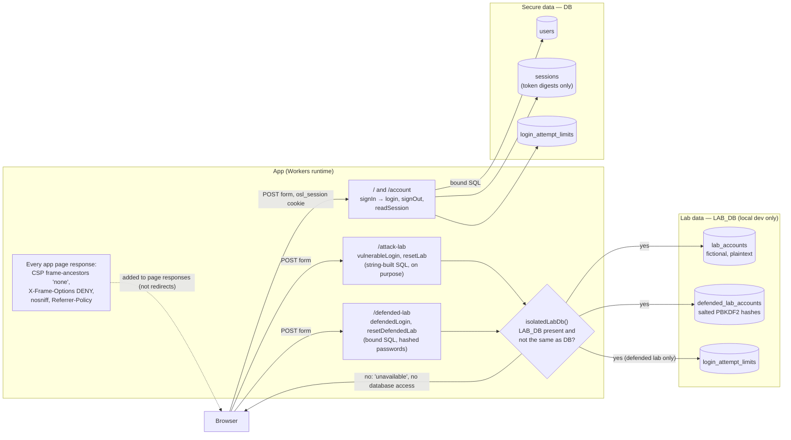

# Architecture and data flow

How a browser request reaches each database, and where the trust boundaries are. Based on `codex/development` `af8dbec` (2026-11-18). Part of [issue #12](https://github.com/QuinnRana/operation-secure-login/issues/12).

## Components

| Component | What it is |
|---|---|
| Browser | Any modern browser. Pages are React; forms submit to server actions with a normal `POST`. |
| App | One vinext (Next.js-compatible) app running on the Cloudflare Workers runtime: locally through `pnpm dev`, in production on the hosting platform. |
| Secure database `DB` | A Cloudflare D1 (SQLite) database. Holds the secure login's data. Present locally and in production. |
| Lab database `LAB_DB` | A second, separate D1 database holding only fictional lab data. **Only the local development server provides it**; production builds omit it, so both labs return "unavailable" there. |

## Diagram

The two subgraphs are the **trust boundary**. Nothing in the lab pages can reach `DB`: every lab action gets its database only through `isolatedLabDb()` (`lib/lab-db.ts`), which returns nothing when `LAB_DB` is missing or is the same binding object as `DB`. That is why an injection on `/attack-lab` can read the lab tables but not `users` or `sessions`. This is a code-level guarantee: the check compares bindings, so physical separation relies on the two databases having distinct local IDs (`db/local-bindings.ts`).

## Request flows

**Secure login (`/`)**
1. The form posts to `signIn` (`app/session-actions.ts`), which calls `login` (`app/actions.ts`).
2. `login` checks the input (one string username of up to 256 characters and one password of up to 1,024), then reserves a rate-limit attempt in `DB` (`lib/login-security.ts`; 5 per account per minute).
3. It looks up the user with a **bound parameter**, hashes the attempt with **PBKDF2-SHA-256** (`lib/password.ts`) and compares the hashes without stopping at the first differing character (`safeEqual`; this is not a guaranteed constant-time comparison).
4. On success, `signIn` creates a session (`lib/session.ts`): a random 32-byte token in an `osl_session` cookie that is `HttpOnly`, `SameSite=Lax`, `Path=/`, lasts 30 minutes, and is `Secure` except on plain-http localhost, with only its SHA-256 digest stored in `sessions`. The browser is redirected to `/account`.

**Account (`/account`)**: reads the cookie and checks the session in `DB` on every request (30-minute absolute expiry); without a valid session it redirects to `/`. **Log out** deletes the session row and the cookie.

**Attack Lab (`/attack-lab`)**: `vulnerableLogin` pastes the form fields into the SQL text, which is the intentional baseline (see the [baseline evidence](evidence/attack-baseline-2026-11-11.md)). Its query targets `lab_accounts`; an injection can read any `LAB_DB` table, but not `DB`. **Reset lab data** re-seeds that table in one transaction.

**Defended lab (`/defended-lab`)**: the same accounts, defended: bound username, salted PBKDF2 hashes, one generic message for a wrong username or password, and its own rate limit in `LAB_DB`. See [DEFENDED-LAB.md](DEFENDED-LAB.md).

**Every app page response** gets the anti-framing and hardening headers from `next.config.ts`. Redirect responses do not, and static files in `public/` were not checked; see [SESSIONS.md](SESSIONS.md).

## Where each table is created

Tables are created lazily on first use, not by a migration step.

| Table | Database | Created in |
|---|---|---|
| `users` | `DB` | `app/actions.ts` (`prepareDatabase`) |
| `sessions` | `DB` | `lib/session.ts` |
| `login_attempt_limits` | `DB` and `LAB_DB` | `lib/login-security.ts` |
| `lab_accounts` | `LAB_DB` | `app/attack-lab/actions.ts` |
| `defended_lab_accounts` | `LAB_DB` | `app/defended-lab/actions.ts` |

Only `users` is also described in `db/schema.ts` and `drizzle/`.

## Not shown

- The diagram covers the application only, not the hosting platform's own network or access controls.
- Production has no `LAB_DB` according to the repository's configuration (`db/local-bindings.ts` adds it only for the dev server; what the host injects was not checked), so the lab half of the diagram exists only on a local development server.
- The rubric's "VMs or virtual networks" environment is not part of this architecture; whether a local web app satisfies it is for the team to confirm with the instructor.
