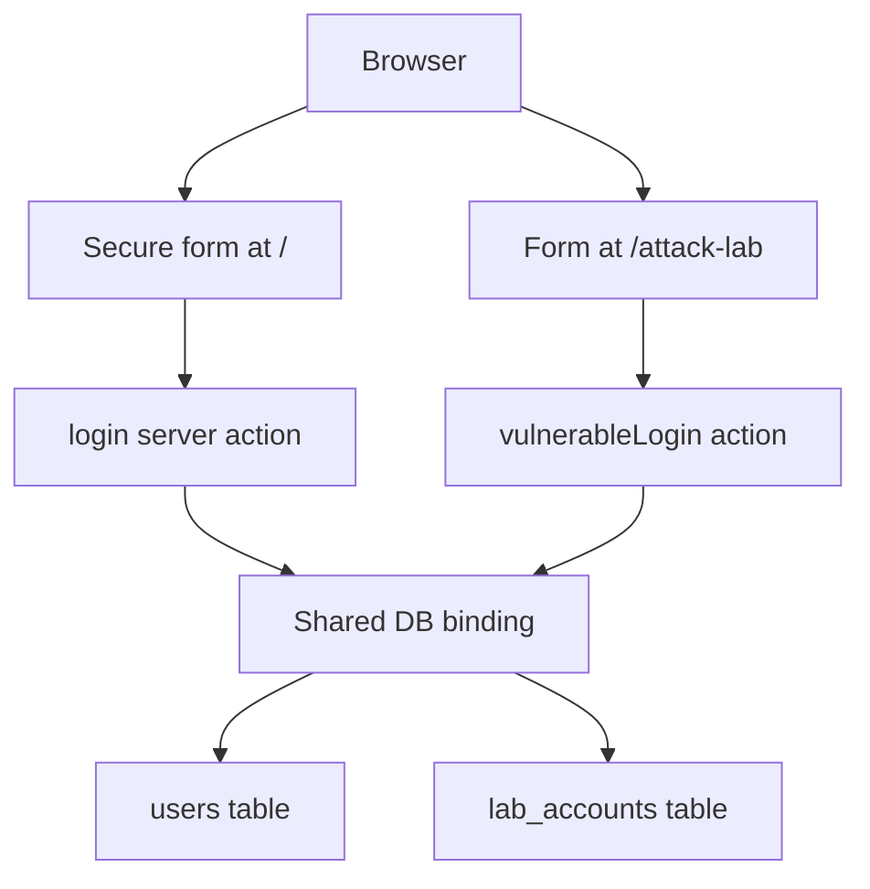

# Architecture and code

[Wiki home](README.md) · Code baseline: [`da12c7c`](https://github.com/QuinnRana/operation-secure-login/commit/da12c7c42336c82a058576fdbe7aa760fac6d794)

## Technology map

| Layer | Implementation | Relevant source |
| --- | --- | --- |
| Browser interface | React 19.2.6 forms and pages | [package.json](https://github.com/QuinnRana/operation-secure-login/blob/da12c7c42336c82a058576fdbe7aa760fac6d794/package.json); components |
| Application runtime | vinext 1.0.0-beta.5; Vite 8.0.13 | package scripts |
| Language | TypeScript 5.9.3 | package.json |
| Styling | Tailwind CSS 4.2.1; UI components | globals.css; components/ui |
| Database runtime | Cloudflare Workers D1 binding named DB | [db/index.ts](https://github.com/QuinnRana/operation-secure-login/blob/da12c7c42336c82a058576fdbe7aa760fac6d794/db/index.ts); server actions |
| Schema tooling | Drizzle ORM 0.45.2 and Drizzle Kit 0.31.10 | [db/schema.ts](https://github.com/QuinnRana/operation-secure-login/blob/da12c7c42336c82a058576fdbe7aa760fac6d794/db/schema.ts); drizzle/ |
| Password helper | Web Crypto PBKDF2-SHA-256 | [lib/password.ts](https://github.com/QuinnRana/operation-secure-login/blob/da12c7c42336c82a058576fdbe7aa760fac6d794/lib/password.ts) |
| Code checks | Oxlint; Oxfmt formatting | package.json and configuration files |

The dependency list is not evidence that every package is exercised by the current login path.

## Request flow

Both actions import `env` from `cloudflare:workers` and call `env.DB.prepare(...)` directly. Drizzle's `getDb()` helper and schema exist, but these two inspected actions do not call that helper. Different tables are not separate database security boundaries.

## Secure login, step by step

Source: [app/actions.ts](https://github.com/QuinnRana/operation-secure-login/blob/da12c7c42336c82a058576fdbe7aa760fac6d794/app/actions.ts).

1. Read username/password from FormData; trim username.
2. Reject empty values with an instruction to enter both fields.
3. Create the users table if absent.
4. Derive the demo password hash and insert the demo user if absent.
5. Select the user's stored hash/salt using `WHERE username = ? LIMIT 1` and bind the username separately.
6. Hash the submitted password using the stored salt and compare using `safeEqual`.
7. Return the same incorrect-credentials message for an unknown username or a wrong password.
8. Return a success message for valid credentials.

The classroom credentials are `student` / `Training123!`, intentionally documented demo values. No session token, authenticated cookie, logout flow, or protected-route enforcement is created by this action.

## Password helper

Source: [lib/password.ts](https://github.com/QuinnRana/operation-secure-login/blob/da12c7c42336c82a058576fdbe7aa760fac6d794/lib/password.ts).

- Imports the password as a PBKDF2 key using Web Crypto.
- Derives 256 bits with SHA-256, a salt, and 120,000 iterations.
- Converts the derived bytes into hexadecimal text.
- Compares equal-length strings by accumulating character differences.

The seeded account uses a fixed, hard-coded demo salt. This is classroom behavior, not a complete account-enrollment design with a unique random salt per account. Do not describe the helper as a blanket production-security guarantee or proof of runtime constant-time execution.

## Database structures

| Table | Fields | Creation and use |
| --- | --- | --- |
| users | id, username, password_hash, password_salt, created_at | Created and seeded by prepareDatabase; used by secure login |
| lab_accounts | id, username, password, display_name, role, private_note | Created and seeded by prepareLab; used by vulnerable demonstration |

Drizzle defines the users schema and a username index. The attack table is created in its server action. Local initialization runs when the actions execute; simply viewing a page does not establish that the tables are initialized.

## Attack lab

Source: [app/attack-lab/actions.ts](https://github.com/QuinnRana/operation-secure-login/blob/da12c7c42336c82a058576fdbe7aa760fac6d794/app/attack-lab/actions.ts).

The action inserts three fictional accounts when the table is empty. Its SELECT query concatenates submitted values into quoted SQL text. The supplied classroom test changes the query's meaning and can return the three fictional records. The UI returns the query and result for educational evidence.

| Fictional name | Role | Demonstration note |
| --- | --- | --- |
| Alex Morgan | Finance Intern | Invoice review due Friday |
| Jamie Lee | Help Desk | Temporary badge 1042 |
| Casey Rivera | Operations | Vendor meeting moved to 3 PM |

This bypass demonstrates unsafe query construction; it does not mean the tester discovered a user's password. Plaintext passwords and disclosed queries are intentional baseline weaknesses, tracked for defense in #8. Use only the payload shown on the authorized local page.

## Source navigation

| Path | Purpose |
| --- | --- |
| app/page.tsx | Secure login page |
| components/login-form.tsx | Secure form and result display |
| app/actions.ts | Secure login lookup and demo initialization |
| app/attack-lab/page.tsx | Lab explanation and authorized test instructions |
| components/attack-form.tsx | Lab form, query display, and record display |
| app/attack-lab/actions.ts | Vulnerable query and fictional data initialization |
| lib/password.ts | Password derivation and comparison |
| db/index.ts | Drizzle D1 access helper |
| db/schema.ts | Users schema |
| drizzle/ | Schema migration and metadata |
| vite.config.ts | Build/runtime configuration |
| .openai/hosting.json | DB binding configuration |
| pnpm-lock.yaml | Locked dependency graph |
